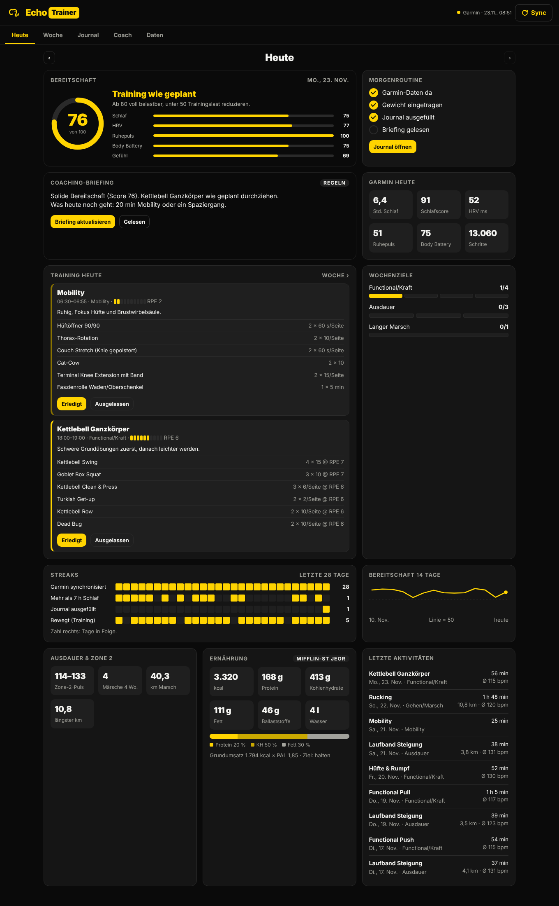
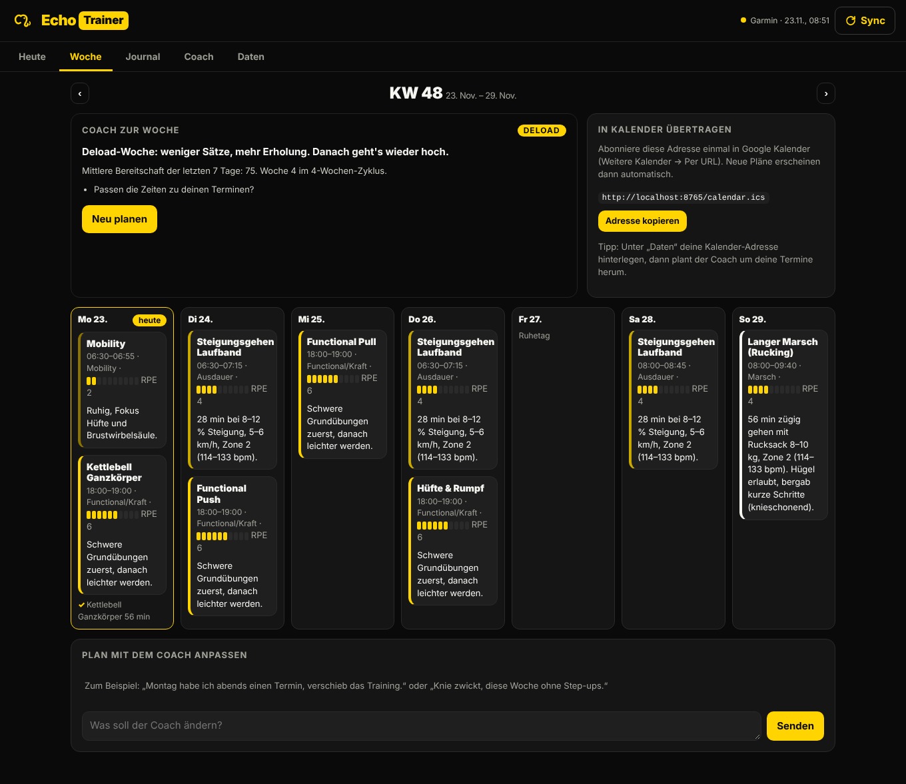

<p align="center"></p>

# EchoWP Trainer

Persönlicher Performance-Coach auf Basis deiner Garmin-Daten. Die Idee stammt aus dem
Video [„Garmin + Claude = mein eigener Performance-Coach“](https://www.youtube.com/watch?v=QeuDmuqpIpE):
Garmin sammelt die Daten, die App macht daraus einen Tagesplan, eine Trainingswoche und
einen Coach, mit dem man reden kann.

**Aktuelle Version: 1.2.0** (Android-App) – Download unter [Releases](https://github.com/EchoWP-Design/echowp-trainer/releases/latest)



## Was die App kann

- **Bereitschafts-Score (0–100)** aus Schlaf, HRV, Ruhepuls, Body Battery und deinem
  Gefühl. Das Gefühl zählt am meisten und deckelt den Score, wenn Garmin dich fit sieht,
  du dich aber nicht so fühlst. Ab 80 voll belastbar, unter 50 Last reduzieren.
- **Coaching-Briefing** für den Tag: wie geplant, angepasst (RPE, Sätze) oder Recovery.
- **Wochenplanung** auf Knopfdruck. Schwerpunkt Functional Fitness (Eigengewicht,
  Kettlebell, Gewichte), Ausdauer als Steigungsgehen auf dem Laufband, am Wochenende ein
  langer Marsch mit Rucksack. Knieschonend: kaum Laufen, keine Sprünge. 4-Wochen-Zyklus
  mit Deload, Entlastungswoche bei niedriger Bereitschaft. Plant um Termine aus deinem
  Kalender herum.
- **Kalender** (Server-Version): Der Plan steht als abonnierbarer iCal-Feed bereit
  (Google Kalender → „Per URL hinzufügen“).
- **Chat** mit dem Coach, auch um den Wochenplan umzubauen („Montag Termin, verschieb das“).
- **Journal** mit Gefühlsfeedback (Stimmung, Energie, Motivation, Muskelkater, Stress),
  Gewicht, Notizen sowie RPE und Feedback zu jedem Training.
- **Essen mit Kalorienzählen** (ab App 1.1): Barcode-Scanner für ganze Packungen, Portionen
  oder Gramm (Open Food Facts), KI-Schätzung aus Freitext, **Food Memory** für häufige
  Lebensmittel mit einem Tipp, Tagesbilanz von Kalorien und Makros gegen deine Ziele.
- **Mehrere Uhren** (ab App 1.2): neben Garmin auch Amazfit (Zepp-App), Suunto und andere
  Uhren über Android Health Connect. Schritte, Kalorien, Schlaf, Ruhepuls, HRV und Trainings
  laufen zusammen, doppelte Trainings werden erkannt.
- **Startseite** mit Schritten und Kalorien des Tages: Ruhekalorien + Aktivkalorien = Gesamt.
- **Ernährungsziele** aus dem Verbrauch der Uhr (Ruhe- plus Aktivkalorien, abschaltbar) oder nach
  Mifflin-St Jeor bzw. Jans Excel-Formel, siehe
  [docs/ERNAEHRUNG.md](docs/ERNAEHRUNG.md).
- **Morgenroutine, Wochenziele und Streaks** als kleine Gamification.
- Läuft als **Android-App** direkt auf dem Handy (ohne Server) oder als **Web-App (PWA)**
  mit eigenem Server.



## Garmin

Drei Wege, Details in [docs/GARMIN.md](docs/GARMIN.md):

1. **Offizielle Garmin Connect Personal API** (empfohlen): Schlüssel in Garmin Connect
   erstellen, als `GARMIN_PERSONAL_API_KEY` eintragen, fertig.
2. Inoffizieller Garmin-Connect-Zugang über `garminconnect` als Reserve.
3. Import von FIT-Dateien und Garmin-Datenexport ohne Online-Zugang.

### Amazfit, Suunto und andere Uhren (Android-App)

Zepp (Amazfit) und Suunto bieten keine offene Schnittstelle für Privatnutzer an (Suunto nur
für zugelassene Firmenpartner). Beide Apps schreiben ihre Daten aber nach **Health Connect**,
dem Gesundheitsspeicher von Android. Die App liest dort mit Erlaubnis mit:

1. In der Zepp- bzw. Suunto-App die Verbindung zu Health Connect einschalten.
2. In EchoWP Trainer unter Daten → „Weitere Uhren“ auf **Health Connect verbinden** tippen und
   die Leserechte erlauben.

Gelesen werden Schritte, Aktiv-, Gesamt- und Ruhekalorien, Schlaf, Ruhepuls, HRV und Trainings.
Garmin-Werte haben Vorrang, Health Connect füllt Lücken. Bei Schritten und Kalorien zählt der
höchste Wert einer App (keine doppelte Zählung, wenn zwei Apps denselben Tag schreiben).
Trainings, die Garmin schon geliefert hat (Start höchstens 10 Minuten auseinander), werden nicht
doppelt gezählt. Braucht Android 8 oder neuer, unter Android 14 die Health-Connect-App.

## KI-Coach

Mit `ANTHROPIC_API_KEY` formuliert Claude Briefing, Wochenplan und Chat-Antworten
(Standardmodell `claude-opus-5-5`, änderbar über `TRAINER_MODEL`). Ohne Schlüssel läuft
alles regelbasiert weiter. Der Wochenplan kommt dann direkt aus dem Planer.

## Android-App (ohne Server)

Die App in `app/` läuft komplett auf dem Handy: Sie holt die Garmin-Daten direkt über die
Personal API, rechnet Score, Plan und Ernährung selbst und spricht für den KI-Coach direkt mit
Claude. Daten bleiben auf dem Handy, die Schlüssel liegen im sicheren Speicher von Android.

**Installieren**
1. Unter [Releases](https://github.com/EchoWP-Design/echowp-trainer/releases) die neueste
   `EchoWP-Trainer.apk` auf dem Handy herunterladen und öffnen. Android fragt einmal, ob der
   Browser Apps installieren darf: erlauben.
2. App öffnen → Reiter **Daten** → Garmin Personal API Key einfügen → Speichern.
   Die App lädt sofort die letzten 14 Tage. Für Amazfit, Suunto & Co. zusätzlich
   **Health Connect verbinden** (siehe oben).
3. Im selben Reiter den Anthropic-API-Key für den KI-Coach einfügen.
4. Profil (Größe, Geburtsjahr, Geschlecht, Gewicht) eintragen, dann unter **Woche** planen.

**Essen (ab 1.1):** Kalorien und Makros zählen gegen die Tagesziele. Eintragen per Barcode-Scan
(Open Food Facts, ganze Packung, Portion oder Gramm), per Freitext mit KI-Schätzung durch Claude
oder von Hand. Das Food Memory merkt sich alles Gegessene für den nächsten Eintrag mit einem Tipp.
Unbekannte Barcodes tippst du einmal ab, danach kennt die App das Produkt.

**Updates (ab 1.1.1):** Die App prüft einmal am Tag auf GitHub, ob es eine neue Version gibt,
und zeigt dann oben einen Hinweis. „Laden“ öffnet die APK im Browser, danach über die
vorhandene App installieren. Manuell: Reiter Daten → Updates.

**Kalorien (ab 1.2):** Die Startseite zeigt Ruhekalorien + Aktivkalorien = Gesamtverbrauch.
Das Tagesziel ist dann Ruhe + Aktiv mit dem Zu- oder Abschlag des Ziels (Abnehmen −15 %,
Aufbauen +10 %). Für heute gelten als Ruhekalorien der Schnitt der letzten 7 Tage, die
Aktivkalorien wachsen über den Tag mit. Schalter unter Daten → Profil.

Beim Öffnen synchronisiert die App automatisch, wenn der letzte Abruf älter als eine Stunde ist.

**Bauen:** GitHub Actions (`.github/workflows/android.yml`) erzeugt die Android-Ordner per
`flutter create`, passt sie mit `app/tool/patch_platforms.py` an, prüft (`flutter analyze`,
`flutter test`) und veröffentlicht die APKs als Release. Für Updates ohne Neuinstallation
braucht das Repo die Secrets `ANDROID_KEYSTORE_B64` und `ANDROID_KEYSTORE_PASSWORD`
(jede EchoWP-Schlüsseldatei, der Schlüsselname wird automatisch erkannt), sonst entsteht eine Testversion mit Debug-Signatur.

Lokal: `cd app && flutter pub get && flutter test`. Mit echten Schlüsseln:
`GARMIN_PERSONAL_API_KEY=… ANTHROPIC_API_KEY=… dart run tool/live_check.dart`.

## Server-Version starten

### Docker (Server, NAS, Raspberry Pi)

```bash
cp .env.example .env      # ausfüllen, mindestens TRAINER_TOKEN und GARMIN_PERSONAL_API_KEY
docker compose up -d --build
```

Dann `http://<server>:8080` öffnen. Daten liegen in `./data` (SQLite).
Für den Zugriff von unterwegs einen Reverse Proxy mit HTTPS davorsetzen.

### Lokal

```bash
python -m venv .venv && source .venv/bin/activate
pip install -r requirements.txt
cp .env.example .env
set -a; source .env; set +a
python -m trainer.app            # http://localhost:8080
```

Zum Ausprobieren ohne Uhr: `TRAINER_DEMO=on python -m trainer.app`.

### Tests

```bash
pip install -r requirements-dev.txt
pytest
```

## Aufbau

| Pfad | Inhalt |
|---|---|
| `trainer/garmin/` | Datenquellen: Personal API, Garmin Connect, FIT/Export-Import, Demo |
| `trainer/readiness.py` | Bereitschafts-Score |
| `trainer/planner.py` | Regelbasierte Wochenplanung und Übungskatalog |
| `trainer/coach.py` | KI-Coach (Claude) mit Regel-Rückfall |
| `trainer/nutrition.py` | Kalorien- und Makrorechner |
| `trainer/service.py` | Fachlogik, verbindet alles |
| `trainer/app.py` | FastAPI: REST-API, iCal-Feed, Web-App |
| `trainer/static/` | Oberfläche (HTML/CSS/JS ohne Build), Icons, Schrift Inter |
| `tools/` | Generator für die App-Symbole |

## Design

EchoWP Corporate Design: Gelb `#FFD400` und Schwarz `#0A0A0A`, Schrift Inter, Wortmarke
„Echo“ mit Produktblock „Trainer“. App-Symbol: runder EchoWP-Elefant mit Echo-Bogen und
einer Kettlebell als Produktzeichen. Dunkel Gelb auf Schwarz, hell schwarze Akzente mit
schwarzen Kopfleisten.

## Rechtliches

**Kein Medizinprodukt.** EchoWP Trainer ist ein privates Trainingswerkzeug und ersetzt keine
ärztliche Beratung, Diagnose oder Behandlung. Bereitschafts-Score, Trainingspläne,
KI-Antworten und Kalorienwerte sind Schätzungen und können falsch sein. Bei Schmerzen,
Krankheit, Brustschmerz, Schwindel oder anderen Warnzeichen Training abbrechen und ärztlich
abklären lassen. Nutzung auf eigene Verantwortung.

**Datenschutz.** Die Android-App speichert alle Daten (Garmin-Werte, Journal, Essen, Pläne)
nur auf dem Handy, die Schlüssel im sicheren Speicher von Android. Daten gehen nur an:
- **Garmin** (Abruf deiner eigenen Daten über die Personal API),
- **Health Connect** auf dem Handy (nur lesen, nur wenn verbunden; bleibt auf dem Gerät),
- **Anthropic** (nur wenn ein Anthropic-Key eingetragen ist: Briefing, Wochenplan, Chat und
  KI-Schätzung beim Essen; dabei werden die dafür nötigen Trainings-, Gesundheits- und
  Essensdaten übertragen),
- **Open Food Facts** (nur der gescannte Barcode).

Es gibt keine eigenen Server, keine Werbung und kein Tracking. Die App ist für den
persönlichen Gebrauch gebaut. Wer sie für andere Personen anbietet, braucht eine eigene
Datenschutzerklärung, weil Gesundheitsdaten besonders geschützt sind (Art. 9 DSGVO).

**Quellen und Lizenzen**
- Produktdaten zum Barcode: [Open Food Facts](https://world.openfoodfacts.org), Datenbank unter
  [Open Database License (ODbL)](https://opendatacommons.org/licenses/odbl/1-0/), Inhalte unter
  [CC BY-SA 4.0](https://creativecommons.org/licenses/by-sa/4.0/).
- Schrift Inter unter der SIL Open Font License (`app/assets/fonts/OFL-LICENSE.txt`).
- Quellcode dieses Repos: [MIT-Lizenz](LICENSE).

**Marken.** Garmin, Garmin Connect und Body Battery sind Marken von Garmin Ltd., Claude ist eine
Marke von Anthropic. Amazfit, Zepp und Suunto sind Marken ihrer Inhaber. EchoWP Trainer ist ein unabhängiges Projekt und mit keinem dieser
Unternehmen verbunden.
